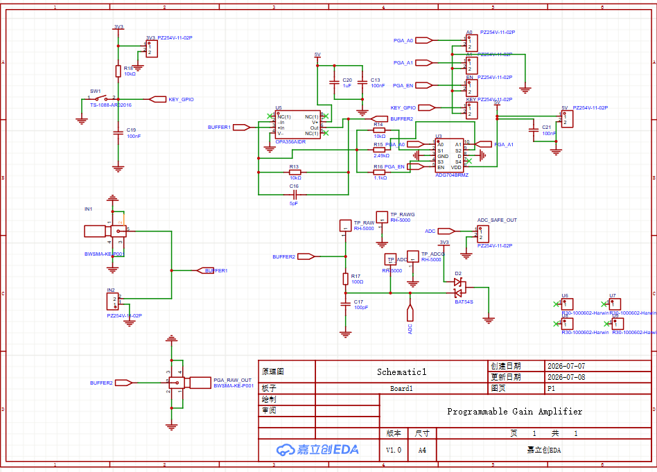
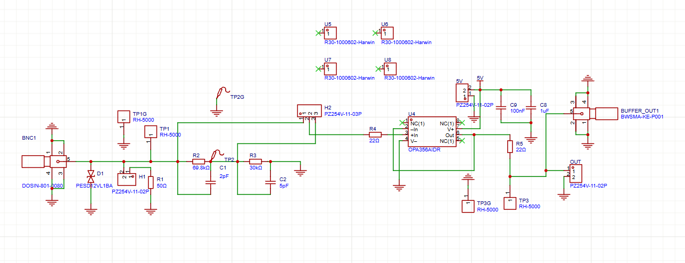
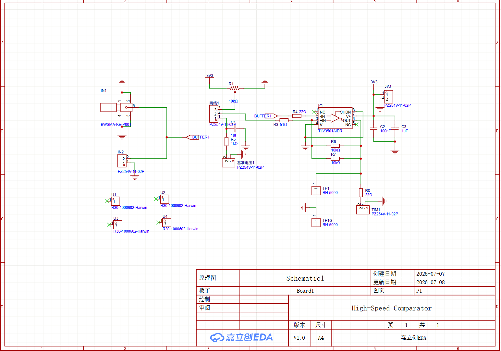
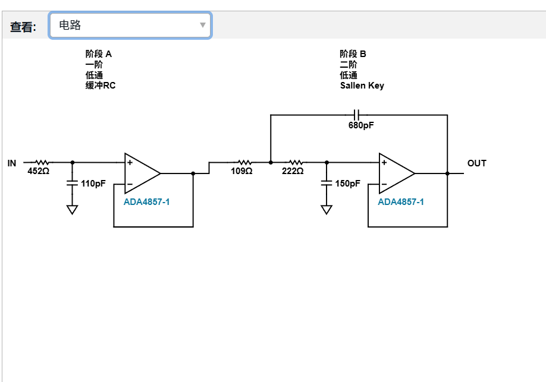
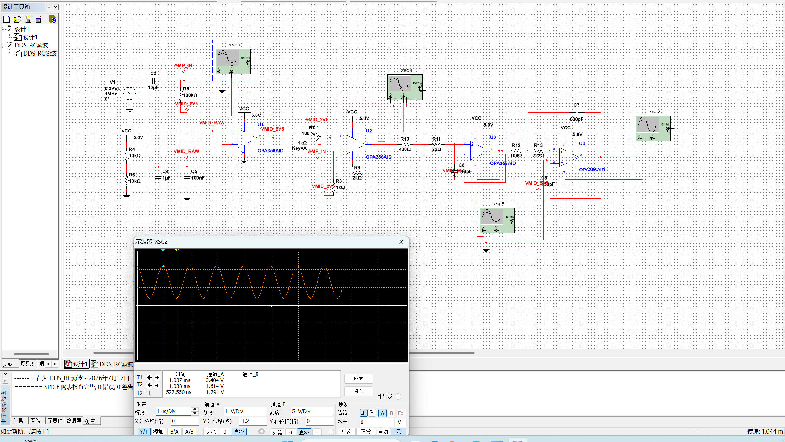

# 电子设计 · 模块实验室

**电赛赛前积累 / 模拟信号链 / 嵌入式模块**

从输入调理、程控放大到 DDS 输出，记录模块设计与实验过程。

[电路图集](#电路图集) · [内容导航](#内容导航) · [展示重点](#展示重点)

---

本仓库汇集赛前准备模块，包含原理图、EDA 工程、仿真及程序。独立参赛作品 ADG704 另行展示；本页各模块属于不同阶段的准备与探索。

## 电路图集

| 输入前端 | 高速比较器 |
| :---: | :---: |
|  |  |
| 输入信号调理模块 | 信号整形与测量接口 |

### 程控增益放大

OPA356 与 ADG704 组成的程控放大设计，包含控制接口与 ADC 输出保护相关电路。设计细节见原图，性能以对应实验为准。

### DDS 后级滤波探索

缓冲 RC 与二阶 Sallen-Key 低通方案记录。

展开查看仿真与其他设计版本

[设计版本 V1](Docs/Images/原理图V_1.png) · [V2](Docs/Images/原理图V_2.png) · [V3](Docs/Images/原理图V_3.png) · [V4](Docs/Images/原理图V_4.png) · [V5](Docs/Images/原理图V_5.png)

## 内容导航

| 目录 | 内容 |
| --- | --- |
| `Hardware/EDA_Project` | DDS、比较器、程控增益放大与输入前端等设计工程及 BOM |
| `Simulation/Multisim` | 输入前端、DDS 后级滤波等仿真工程 |
| `Docs/Images` | 原理图与仿真截图 |
| `Docs/Proposal` | 赛前方案论证、引脚规划及迭代记录 |
| `Software/M0G3507_Code` | MSPM0G3507 外设与信号处理模块 |
| `Software/STM32_Code` | STM32 软件工程 |

## 展示重点

- 输入信号调理、程控放大、高速比较器与 DDS 后级模拟滤波。
- 原理图设计与仿真验证过程。
- ADC、DMA、定时器测量、DAC 与显示等嵌入式模块积累。

文档中的指标可能属于设计目标，具体完成状态和实测结果需结合对应实验记录判断。

## 独立参赛作品

后续电赛采用独立的 ADG704 工程，获 2026 年重庆市电子设计大赛三等奖。[查看独立参赛项目](https://github.com/ZXY1110101/Lissajous-Control-STM32)。本仓库保留赛前准备过程。
